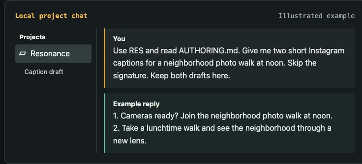

# Resonance

**See what you have said online and how it may land. Fix it in your own voice. Privately, on your own computer.**

`0.1.0-rc.1 · source and Windows release candidate`

## Start in Codex or Claude Code

1. Download the [RES source ZIP](https://github.com/Bill-Viking/resonance/releases/download/v0.1.0-rc.1/Resonance-0.1.0-rc.1-source.zip) and extract it. Find the folder containing `AUTHORING.md` and `ASSISTANT.md`.
2. Open that folder as a **local project** in Codex, or choose **Code → Local → Open folder** in Claude Desktop. Start a chat in that project.
3. Try **“Use RES and read AUTHORING.md. Give me two short Instagram captions for a neighborhood photo walk at noon. Skip the signature. Keep both drafts here.”** The drafts appear in the same chat.



You can draft directly in the project chat. For a visual workspace with saved posts, accounts and reports, ask the assistant to start the local dashboard. [Illustrated user manual for both apps](static/guide/USING-RES.md)

Resonance is a free, open-source app under the [MIT license](LICENSE) that runs on your own computer. It gathers your own posts, comments and replies into one place, marks the exact words that may land badly with the audience of that account, and helps you keep, change or remove each one. It has no account to create, no cloud behind it and no tracking inside it.

For the standalone Windows dashboard, download the [signed Windows x64 ZIP](https://github.com/Bill-Viking/resonance/releases/download/v0.1.0-rc.1/Resonance-0.1.0-rc.1-windows-x86_64-signed.zip), extract the whole folder, and open `Resonance.exe`. It includes Python. The Apple Silicon app is awaiting Apple signing and notarization. Mac users can use the source ZIP in Codex or Claude Code today. [Desktop guide](docs/DESKTOP.md)

**The browser reader is a preview, not available in a store yet.** The candidate includes account discovery, Check now, saved receipts and text history for up to three recent own X main-timeline posts (not replies to other people) or YouTube comments per account. It requires the separate reader in the same browser and explicit site permission. Ordinary store installation is still a release gate. Paste text, use samples or have your external assistant bring in your posts in the meantime. Other saved platforms, including Instagram and Substack, use those routes. The current YouTube reader requires an English-language interface; opening comment videos may affect watch history or start playback before pausing. See [reader privacy](docs/READER-PRIVACY.md) and [the release notes](CHANGELOG.md).

## Open the optional web dashboard

You need [Python](https://www.python.org/downloads/) 3.9 or newer. Get this folder onto your computer (**Code → Download ZIP**, or `git clone`), open a terminal in it, and run:

| Your computer | Run |
| --- | --- |
| macOS or Linux | `./resonance` |
| Windows | `resonance.bat` |

On Windows, run `py -3 -m pip install -r requirements.txt` once first (`python -m pip …` if you have no `py`). It adds the time-zone data Windows does not include.

Your browser opens Resonance at `http://127.0.0.1:4317`. Leave the terminal window open while you use it; press Ctrl+C there to stop. Everything you saved is kept.

## First run

Welcome starts with **Paste my first post**. Paste your writing, choose the platform and enter your profile link or handle. You can choose **Check wording without an account** to use Compose instead. The next step asks how you want to show up (real name or alias, how daring). **Save & check post** saves the account and post on this computer, then opens the result with Keep, Modify and Delete. Nothing is posted or changed on the platform. If a save cannot be confirmed, refresh checks its status without sending it again. Inspect your saved accounts and posts before starting another attempt.

**Other ways to start** offers samples, browser-reader setup and your own assistant. Samples live in their own file, apart from anything of yours, under a banner that says so. **Clear samples** removes them. Samples never read a real account. Reader setup explains the pending store-installation limit and asks you to confirm any discovered account and its boundaries before saving it.

**Today, Posts and Compose** are the main tabs. Accounts, Mail, Check history and Settings & data remain visible in a quieter row. Today shows what needs your decision, the next action and saved work that has content. Empty work panels stay out of the way; the counts remain visible. Check now depends on the separate reader and supported accounts. Otherwise, Paste a post is the starting action. A zero count describes the saved records, not your whole online account.

**Choose a review** on Welcome and Today opens four choices:

- **Work Safe** reviews public writing and attachments against account boundaries.
- **Privacy Check** looks for exposed personal details and confidential work information.
- **Voice & Tone** reviews how wording may land while preserving intent and voice.
- **Before You Post** opens Compose for a local draft wording check.

The first three prepare a request to copy into your own AI assistant's chat.
Choose one social account or all saved social accounts, then the 25 newest
public items per account or all accessible public posts, comments and replies.
Preparing or copying the request starts nothing and authorizes no platform
changes. Mail and private messages are excluded. Leave samples before preparing
a real-account review. Before You Post preserves your current in-tab draft.

**Social inbox** on Welcome and Today helps you decide what needs a reply.
Choose one saved social account. Ask your assistant to summarize its latest ten
notifications, or name one conversation and ask for a draft based on its latest
ten messages. RES prepares the scoped request for you to copy. You can also
enter summaries yourself, track which need a reply and edit or copy a reply
draft. The workspace clears on page reload or close. Giving the request to
your assistant shares that scope with it. Opening a thread on the platform
may send a read receipt.

## How your posts get in

- **Paste them.** Always available, no assistant needed.
- **Check now with the preview reader.** After setup, a deliberate click reads supported own text, saves a dated receipt with coverage gaps and makes local rule matches available for review. **See what was read** shows the exact saved text, including text with no matches. A saved account is not a current sign-in check. The reader never publishes, edits or deletes.
- **Your assistant brings them.** If you use an AI assistant that can drive a browser and run a command, give it one sentence — *"Read ASSISTANT.md in my Resonance folder and run my Resonance check."* — and it does the rest: it reads your own posts where you are signed in, saves what it found, and your tiles fill in. [ASSISTANT.md](ASSISTANT.md) is the whole contract it follows, written to be read by you too. The short version: your own writing only, never private messages, and nothing on a platform is changed without current user authorization. Permanent deletion always needs your current yes for that exact item. Only an explicit Work Safe delegation may cover recoverable removal or its specified fallback edit within a defined scope, where the tool permits preauthorization; every tool-required confirmation still applies.
  Facebook checks that include comments or replies start from your own Comments
  activity log. The assistant collects the loaded rows into a private navigation
  inventory, including replies on other people's posts, then checks their exact
  sources. You do not need to supply names, topics or links. Missing rows and
  unfinished loading stay visible as coverage gaps. This is an
  [assistant-led discovery workflow](docs/FACEBOOK-DISCOVERY.md), not background
  monitoring or Facebook support in the preview browser extension.
- **Ask for a Work Safe audit.** Tell your assistant, “Run a Work Safe audit on [platform/account] for [scope].” “Safe Work” means the same thing. It follows the same contract and report, and checks only the public writing and attachments it can actually inspect. The request does not authorize a platform change. See the [procedure](docs/SAFE-WORK.md) and the packaged [Work Safe skill](skills/res-work-safe/SKILL.md).
  Coverage distinguishes your posts from your comments and replies on other
  people's posts. The skill's local completion checker holds the audit partial
  while recorded targets, requested surfaces or action results remain unresolved.
  It checks the assistant's record; it cannot discover omitted content or prove
  what happened on a platform.
- **Your own data archive.** Importing a platform's "download your data" file is not available in this edition.

- **Comments addressed to RES.** If you leave a public comment or reply that starts with `RES:`, `Hey RES,` or `@RES`, your assistant can bring it in as a request for an evaluation and a proposed edit or follow-up. Resonance does not watch your accounts and reacts to nothing instantly: it appears under **RES requests** on Today only after your assistant has checked and imported it. Being addressed to RES grants no access and starts nothing. You review it, and anything posted, edited or removed still needs its own separate yes.

Saved accounts can be on X, Reddit, YouTube, Instagram, Facebook, TikTok, LinkedIn, Discord, Substack and Threads, plus Gmail and Outlook mailboxes. Saving an account connects nothing. Threads can be saved by handle or profile link, and appears in ordinary account setup and reports; Resonance has no Threads reader or direct connection. What Resonance can show depends on what you paste or what your assistant was able to read, and every check says plainly what it covered and what it could not reach.

### Proven with

An assistant is listed here only after it has run the whole road on this contract: read posts, saved a report, tiles appeared.

| Assistant | Computer | What was run | When |
| --- | --- | --- | --- |
| *No rows yet.* | | | |

## What you can do with a post

Each post gets one card showing the saved text with the flagged words marked. Assistant-supplied context can show the parent conversation or attachment, when it was inspected, and a small local image preview. Uninspected or missing context is labeled; the app does not fetch or analyze media. **Keep** it, **Modify** it, **Delete** it, or **Snooze** it for a day. Modify and Delete each offer two roads: do it yourself, with the original opened for you, or ask your assistant. **Retract** fills in a withdrawal notice you can reword.

Resonance is careful about what it claims. Clicking a button never changes a platform. "Deleted" appears only after the result was checked on the platform itself; until then the card says what is true — asked, done by you and not yet verified, or blocked, with the reason and the next move.

Before an assistant edit or removal starts, a fresh account check must match the saved identity and the source's author. The action preview shows the intended account, its boundary and the assistant's dated observation together. Missing, mismatched or expired checks hold the action; an alternate account is never substituted automatically. The assistant observes your browser's sign-in through its own tools; Resonance cannot see or monitor that sign-in itself.

Edit availability is checked for each exact post. Cards show the assistant’s dated observation and reason; unknown stays unknown. Assistant edits require fresh available text-edit controls as well as the account match. When editing is unavailable, Res offers Keep, a follow-up reply draft or a separate-post draft. These drafts stay in the current tab for copying and separate review; Res does not publish them or remove the original.

For public writing or artwork you separately ask an assistant to create through
Resonance, [the authoring workflow](AUTHORING.md) starts with no RES signature or
banner. From **Settings & data**, open **Preferences: personal brand and RES credit**. Under **RES credit on public drafts**, you can opt into a
short or full signature and independently request your approved banner. Your
instruction for a particular item takes priority. These settings guide your
external assistant; the app does not add anything to saved text or publish it.

If an Instagram, X or Facebook image post is interrupted, your assistant can
recover the last image you picked even after its original file is gone. It
checks each destination in your browser, saves the link for each confirmed
post and holds a retry while delivery is uncertain. An Instagram share to
Facebook gets its own Facebook check. [Image post recovery](AUTHORING.md#recovering-an-image-post)

## Accounts and boundaries

Every account gets a daring level — careful, balanced or bold — and one question: is it under your real name, or an alias? Accounts under your real name always stay safe-for-work, whatever the daring level. Accounts you have not classified are treated the same way. An alias can relax that on purpose. An alias is not a promise of anonymity.

## Where your data lives

In one folder on your computer, outside this source folder:

| Your computer | Data folder |
| --- | --- |
| macOS | `~/Library/Application Support/Resonance` |
| Windows | `%LOCALAPPDATA%\Resonance` |
| Linux | `$XDG_DATA_HOME/Resonance`, or `~/.local/share/Resonance` |

Resonance prints the folder it is using when it starts, and **Settings → Your data** shows it with its size and the last automatic backup. Set `RESONANCE_DATA_DIR` to use a different folder. Choose a private local folder that none of your sync tools shares: Resonance rejects repositories and the cloud-sync paths it recognizes, but it cannot detect every folder another program syncs.

**Upgrades protect your data.** Before a new version changes the database it saves a copy under `backups/auto` in the data folder. It keeps up to five copies, preserving the original state for the whole upgrade alongside its newest step backups. If a step fails, its copy is put back and Resonance tells you in one sentence.

**Keeping a copy is your choice.** Nothing leaves the folder automatically, and **Export backup** writes a file whenever you ask. Exports are readable JSON, including account names, saved text, context images, drafts, requests and RES-addressed comments. This edition does not encrypt exported backups; keep them in a private location or encrypt them with your own trusted tool. Restoring a backup applies its saved branding choices; the import preview shows any change before you confirm. An upgraded workspace requires this edition or newer. New backups use format 4 and older editions reject them. A restored backup never carries permission to change anything; pending requests ask for your yes again.

## What it does not do

- **It does not understand everything.** The built-in checks are a limited set of English wording rules. They do not read images or video, check facts, or know the whole conversation. No flags means those rules matched nothing in the text that was saved — not that an account is safe.
- **It does not score you.** No grades, no reputation number, no judgment of what kind of person you are. A finding describes how words may read.
- **You choose each inbox review.** Public checks exclude social notifications and private messages. For inbox help, you select the account and the notifications feed or one conversation. You decide what to do with each suggested reply.
- **It does not act on its own.** The app contacts no platform, holds no password or token, and has no AI model inside. Collecting posts and making a change you approved are your assistant's work, in its own tools, under its own confirmations.
- **It does not sign you in.** A saved account is a note about where you post, not a connection.

## Security

Resonance listens on this computer only, answers only to its own address, and accepts changes only from its own page. It has no sign-in of its own, so it is as private as the computer it runs on. [SECURITY.md](SECURITY.md) says exactly what is checked, where the protection stops, and how to report a problem.

## Development

```
python3 -m unittest discover -s tests
node tests/test_ui_actions.cjs
node tests/test_ui_communication.cjs
node tests/test_ui_today.cjs
node tests/test_ui_reader.cjs
node tests/test_browser_reader.cjs
node tests/test_reader_discovery.cjs
node tests/test_reader_pipeline.cjs
```

Run `python3 server.py --open` from this folder, with `RESONANCE_DATA_DIR` set to a temporary folder so your own data is never touched. The Node suites check views and handlers against a mock page; they do not replace a look in a real browser.

Product direction is in [PRODUCT.md](PRODUCT.md). The reference behind the assistant's contract is in [reports and coverage](docs/MONITORING.md) and [decisions and verified outcomes](docs/ACTIONS.md). What each platform's official access allows is in [INTEGRATIONS.md](INTEGRATIONS.md). AI agents working in this folder start at [AGENTS.md](AGENTS.md).

## License

MIT — see [LICENSE](LICENSE).

Resonance is an independent project. It is not affiliated with, endorsed by or sponsored by any platform it names; their names and marks belong to their owners.
