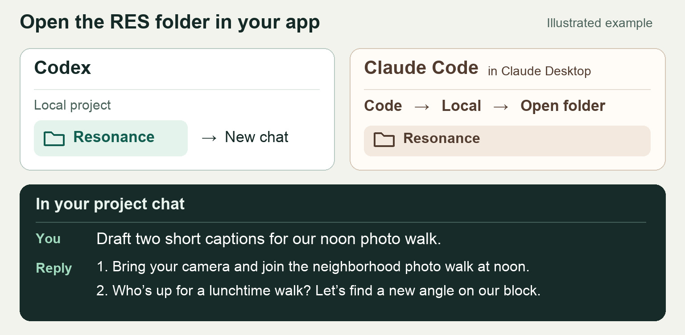
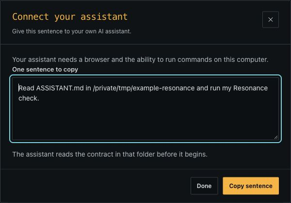
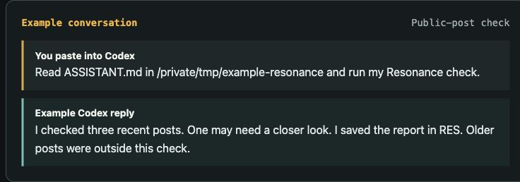
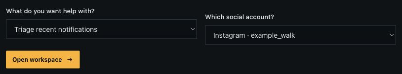
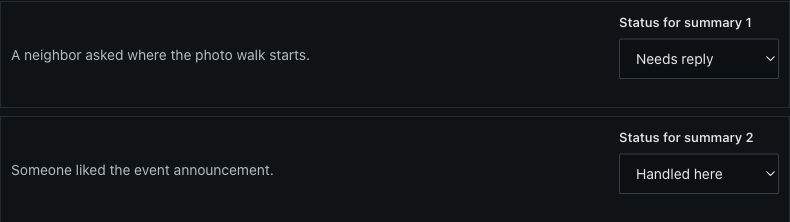

# Use RES inside Codex or Claude Code

## Start with the project chat

1. [Download the RES project for Codex or Claude Code (source ZIP)](https://github.com/Bill-Viking/resonance/releases/download/v0.1.0-rc.1/Resonance-0.1.0-rc.1-source.zip) and extract it. The project folder contains `README.md`, `AUTHORING.md` and `ASSISTANT.md`. You can name the folder **Resonance**.
2. **Codex:** open or add that local project folder, select it in the sidebar and start a chat under it. **Claude Code:** in Claude Desktop’s **Code** tab choose the local environment, select **Open folder**, and pick the same folder. In the terminal edition, open your terminal in the folder and run `claude`. Use a signed-in assistant that can read local files. [Codex quickstart](https://developers.openai.com/codex/quickstart/) · [Claude Code desktop quickstart](https://code.claude.com/docs/en/desktop-quickstart)
3. Ask for a draft in that chat. Try **“Use RES and read AUTHORING.md. Give me two short Instagram captions for a neighborhood photo walk at noon. Skip the signature. Keep both drafts here.”** The assistant reads the project’s public instructions and returns the options in the conversation. You can ask for a shorter or warmer version in the next message.

A first draft needs only the extracted public folder and your local assistant. To review actual posts, ask the assistant to read `ASSISTANT.md` and run your RES check. The saved-data tools need Python, and a live platform review needs an appropriately signed-in browser or connector. The assistant should tell you what it could inspect.

## Open the optional web dashboard

In the same project chat, ask **“Start the local RES server from this folder and open it in the app’s browser or preview pane.”** The source edition needs Python 3.9 or newer. Run `python3 server.py` on macOS or Linux, or `py -3 server.py` on Windows. On Windows, first run `py -3 -m pip install -r requirements.txt`. The server prints its address, normally `http://127.0.0.1:4317`. Open it in the Codex browser, Claude Desktop’s local Browser pane, or your usual browser. Keep the server running while using the dashboard. [Codex browser](https://developers.openai.com/codex/app/browser) · [Claude desktop previews](https://code.claude.com/docs/en/desktop#preview-your-app)

### Check your public writing from the dashboard

1. **In RES**, save the social account you want to check. On **Today**, choose **Ask my assistant** and then **Copy sentence**. The sentence includes the location of the assistant instructions on your computer.

   

2. **In Codex**, open a new local chat on the same computer. If prompted for a project, select the folder named in the copied sentence. Paste the full sentence into the message box and send it. The screenshot uses an example folder. Keep the path from your own installation. Codex needs to be able to read the folder, run local commands and use a browser where you can sign in to the selected account. [OpenAI’s Codex quickstart](https://developers.openai.com/codex/quickstart/)

   

3. **Back in RES**, open **Today → Latest assistant report** or **Check history**. Read the coverage for each account. If Codex could only see three posts, its findings apply to those three. A missing account or a sign-in problem should appear as a coverage gap.

## Triage notifications

The source edition and Windows desktop app include Social inbox. The account and notifications pictured here are fictional.

1. Open **Today → Social inbox**, choose **Triage recent notifications** and select one saved social account. Choose **Open workspace**.

   

2. Under **Ask your assistant**, read the scope and check the authorization box if you want to proceed. Choose **Prepare assistant request**, then **Copy assistant request**. Paste the full request into your local Codex chat. It covers up to ten visible notifications. Opening the list may clear a badge.
3. In the same RES tab, paste one short summary per line and choose **Add summaries**. Pick **Needs reply** for the question you want to answer. **Handled here** records your decision in this tab. Reloading or closing it clears the summaries.

   

For help with one private reply, choose **Draft replies for one private conversation** at the start. Identify the conversation, review the read-receipt notice and bring the suggested wording back to **Your reply**. You decide whether to send it on the platform.
